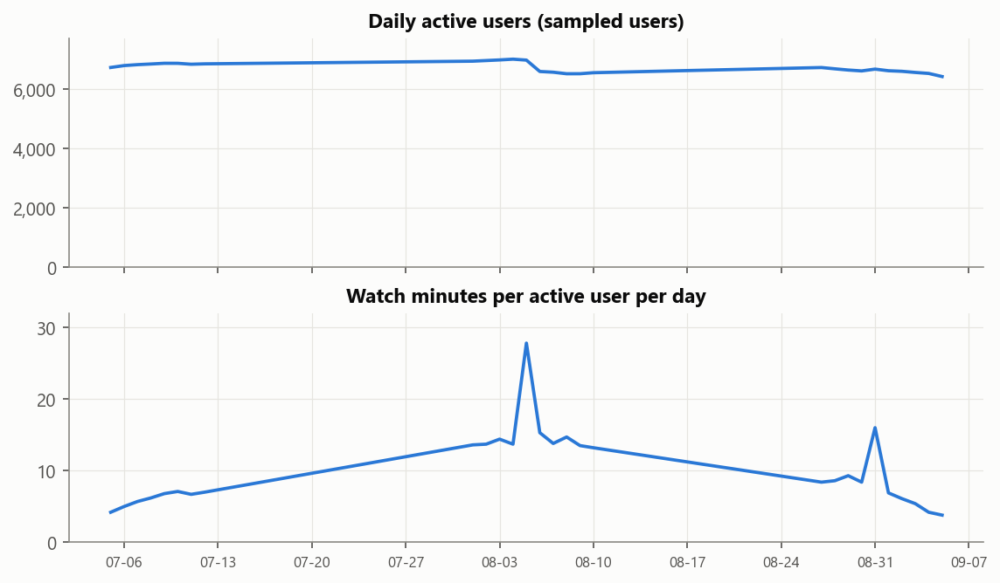
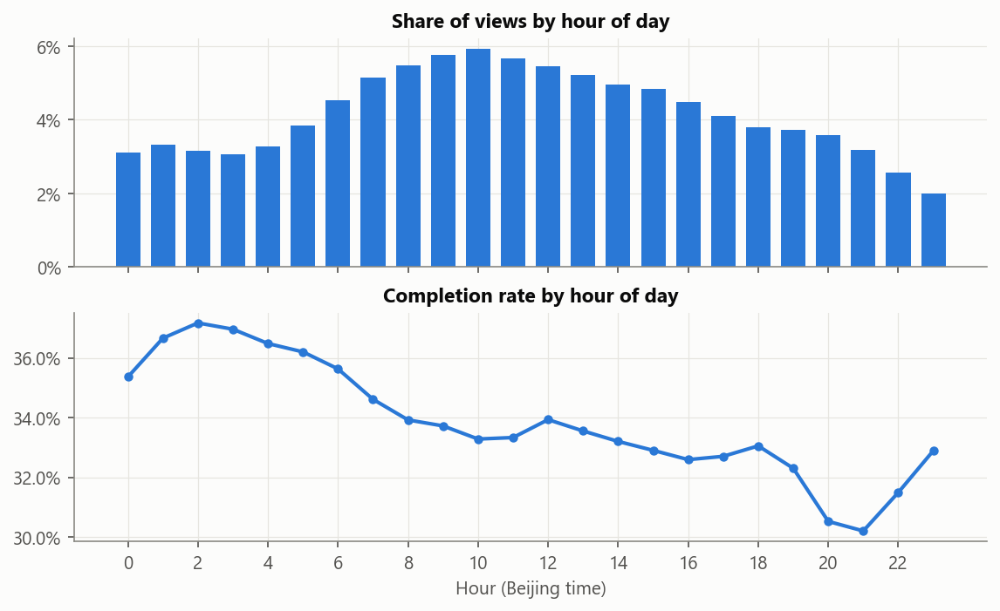
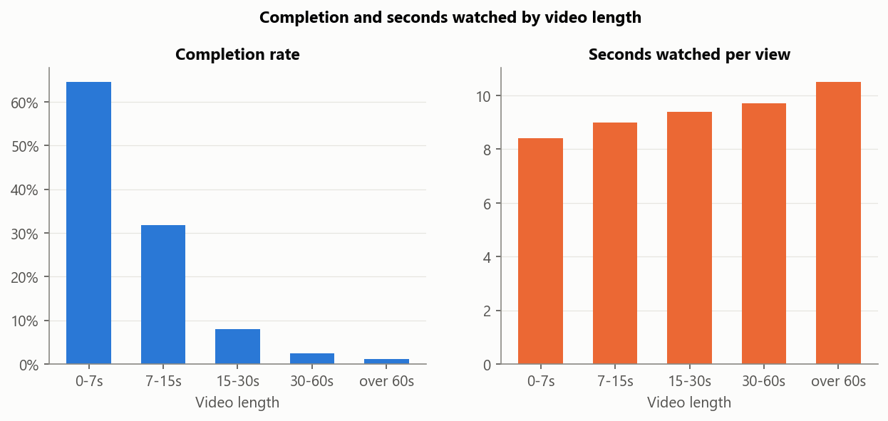
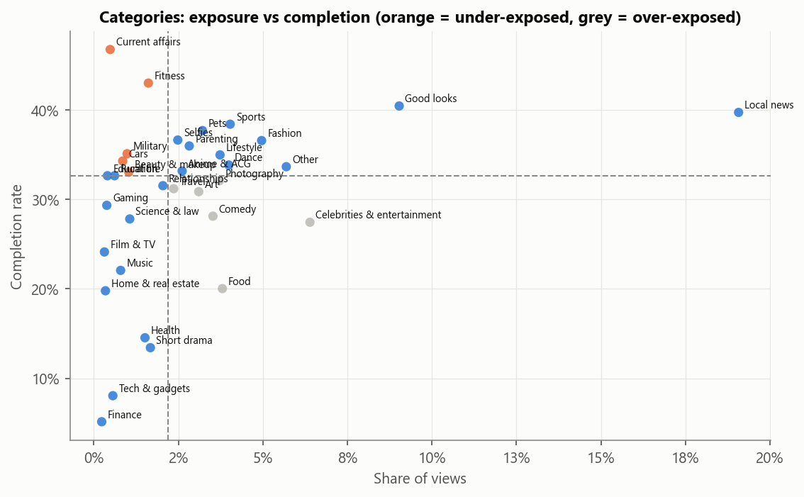
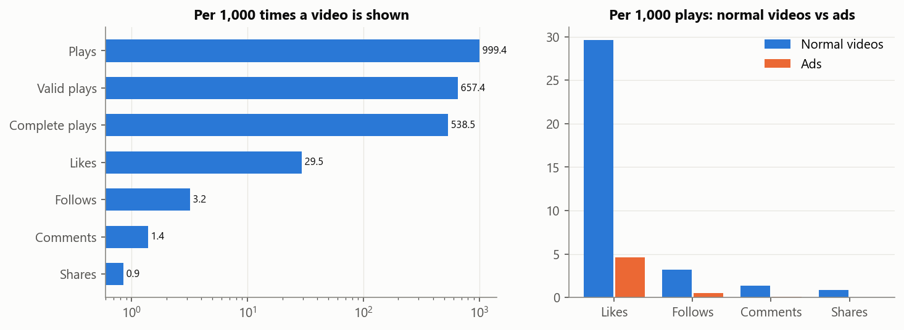
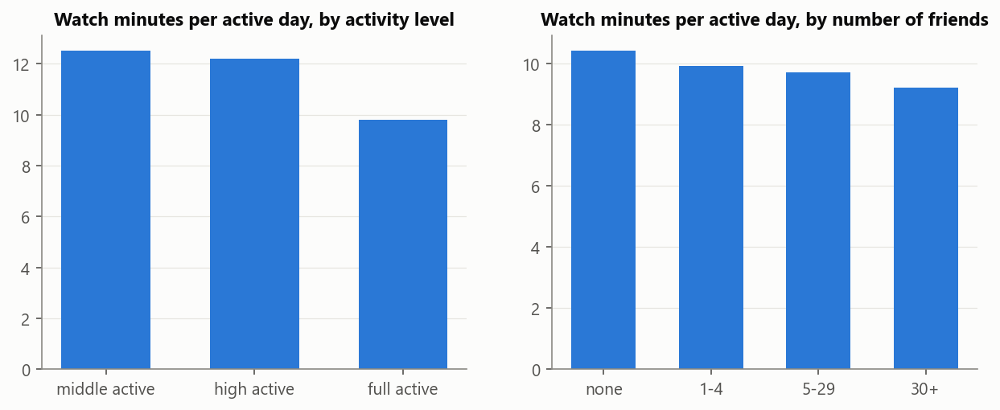
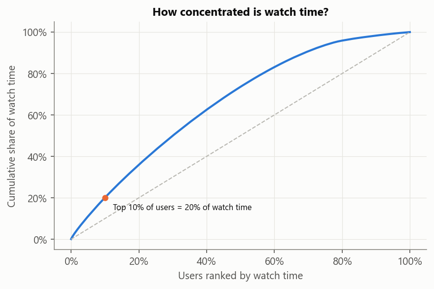
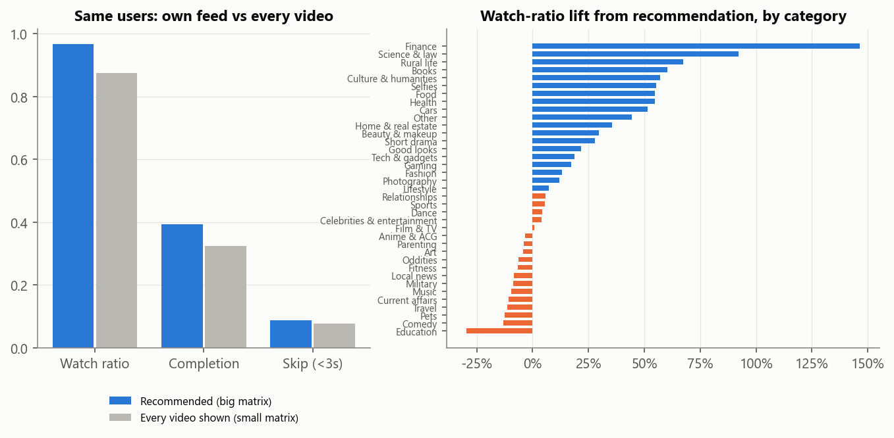

# Kuaishou Short-Video Engagement Analysis (KuaiRec)

> Data: KuaiRec, Kuaishou short-video app, July-September 2020 (Zenodo KuaiRec release (real data))
> 12,530,806 recommended views by 7,176 users on 10,728 videos (2020-06-23 to 2020-09-10),
> plus a fully observed block of 4,676,570 views (1,411 users x 3,327 videos) and platform-wide daily video statistics.
> Watch ratio = play time / video length, capped at 5 for averages (115,291 views were above 5, mostly loops of very short videos).

## 0. Executive summary

| Area | Key numbers | Interpretation |
|---|---|---|
| Engagement | 66.4 views and 10.0 minutes per user per active day; completion 33.8%, skip within 3 s 18.4% | Average video is 15 s |
| Timing | Views peak at 10:00; 18:00-24:00 holds 19% of views | Viewing is spread through the day |
| Video length | Completion falls from 65% (0-7s) to 1% (over 60s); seconds watched per view 8.4 vs 10.5 | Users give each video about 9 seconds whatever its length, so long videos are mostly abandoned rather than watched longer |
| Content mix | 5 categories are under-exposed (above-median completion, below-median share of views) | Re-allocating exposure is a cheap lever |
| Social actions | Per 1,000 shows: 29.5 likes, 3.2 follows, 0.85 shares | Sharing and following are rare, so they are sparse ranking signals on their own |
| Ads | Ads get 0.16x the like rate of normal videos | Ad load has a measurable engagement cost |
| Users | Top 10% of users = 20% of watch time | Watch time is fairly evenly spread across sampled users |
| Recommender | Watch ratio in users' own recommended feed is +10% vs when they were shown every video | Personalisation adds engagement, but unevenly by category |

## 1. Engagement and timing

- Trend analysis uses the 28 core days from 2020-07-05 to 2020-09-05 (days with at least half of the peak daily users; the logs start earlier with only a few users per day). Daily active sampled users ranged from 6,423 to 7,008; weekend watch minutes per user are 0.93x weekdays.
- 96% of the 7,020 users active in the first core week were still active in the last core week (sampled users are a panel, so this is high by design).

- Views peak at 10:00 and completion peaks at 2:00.

## 2. Content: length and category

- Video length vs completion rate, per video (Spearman): 8,372 videos, p = 0, rho = -0.96.
- Seconds watched per view barely change with length (8.4 s for 0-7s vs 10.5 s for over 60s), while completion collapses. Viewers decide within a few seconds; for long videos the opening seconds matter most, and creators should front-load the hook. Ranking on completion would push toward very short clips without losing watch time, so completion is a reasonable target here.

- Under-exposed winners: Current affairs (47% completion, 0.5% of views), Fitness (43% completion, 1.6% of views), Military (35% completion, 1.0% of views), Cars (34% completion, 0.9% of views), Beauty & makeup (33% completion, 1.0% of views).
- Over-exposed: Celebrities & entertainment (27%, 6.4%), Food (20%, 3.8%), Photography (32%, 3.7%), Comedy (28%, 3.5%), Art (31%, 3.1%).
- Views are concentrated: the top 1% of videos get 6.0% of views and the top 10% get 40.7%.

**Recommendation 1: rebalance exposure toward high-completion categories.** Moving just 1% of all views from the over-exposed to the under-exposed group (27.9% vs 38.2% completion) would add about **12,927 completed views** in this sample (+0.10 pp completion). Test as an A/B experiment on the ranking boost, with watch time as a guardrail metric.

## 3. Engagement funnel and ads (platform-wide daily statistics)

- Ads get 4.6 likes and 0.5 follows per 1,000 plays vs 29.6 and 3.2 for normal videos (0.16x the like rate); completion 5.5% vs 54.0%.
- Likes per play: ads vs normal videos (chi-square): 4.6 vs 29.6 per 1k plays, p = 0, ratio 0.16x.

**Recommendation 2: price the engagement cost of ads.** Every slot given to an ad trades away likes and follows. Cap ad frequency for low-tenure users and A/B test ad load, measuring session length and next-day return alongside ad revenue.

## 4. Users

- middle active: 28 users (small group, interpret with care), 12.5 min per active day, 0.3% of all watch time
- high active: 938 users, 12.2 min per active day, 14.0% of all watch time
- UNKNOWN: 118 users, 11.8 min per active day, 1.5% of all watch time
- full active: 6,092 users, 9.8 min per active day, 84.3% of all watch time
- Daily watch minutes: full_active vs middle_active users (Mann-Whitney U, two-sided): median 10.2 vs 12.3 min, p = 0.027, rank-biserial r = -0.24.
- Friends vs daily watch minutes, per user (Spearman): 7,176 users, p = 6.6e-06, rho = -0.05. The correlation is negligible (rho = -0.05): social ties do not explain how much people watch, so friend-graph features are unlikely to move watch time on their own.

## 5. How much does the recommender add?

- Design: 1,411 of the 1,411 fully observed users also appear in the recommender logs. The two matrices share 0 user-video views, so each user's own recommended feed (any video) is compared with the same user's reaction to every video in the 3,327-video pool.
- Recommended feed: watch ratio 0.968, completion 39.2%, quick skips 8.8%. Every video shown: 0.876, 32.4%, 7.8%.
- Recommended feed vs every-video watch ratio, same users (Wilcoxon signed-rank, two-sided): 0.975 vs 0.876 (1411 users), p = 5.3e-114, mean lift +12.4% (95% CI +11.6% to +13.2%); 79% of users higher.
- Lift is highest for Finance (+147%), Science & law (+92%), Rural life (+68%) and lowest for Education (-30%), Comedy (-13%), Pets (-13%).

**Recommendation 3: focus model work on low-lift categories.** Where recommendation barely beats showing everything, the model has not learned user taste; add category-specific features or more exploration traffic there.

## 6. Limitations
1. Users are a sample of Kuaishou users over about two months in 2020; daily video statistics cover all users, so funnel rates and matrix metrics describe different populations.
2. Watch ratio is capped at 5 for averages; very short videos replay automatically, so their ratios are not comparable with long videos without the cap.
3. The small matrix forced exposure in a special collection setting; users may behave differently than in their normal feed, so the lift is an estimate.
4. Category names are translated from Chinese first-level categories; free-text captions and tags are not used.
5. All recommendations are sized from observational data and need A/B tests.
